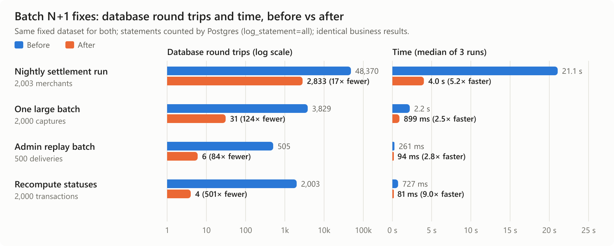

# Batch N+1 fixes: before and after (2026-10-30)

Four batch operations sent one database round trip per row. Each is now
set-based. Every business total we compared is identical (see below); only
the number of round trips changed.

| Operation | Data | Round trips before → after | Time before → after |
|---|---|---|---|
| **Nightly settlement run** (`RunDailyBatch`) | 2,003 merchants, 100 active | 48,370 → **2,833** (17× fewer) | 21.1 s → **4.0 s** (5.2× faster) |
| **One large batch** (`CloseBatch`) | 2,000 captures | 3,829 → **31** (124× fewer) | 2.2 s → **0.9 s** (2.5× faster) |
| **Admin replay batch** | 500 deliveries | 505 → **6** (84× fewer) | 261 → **94 ms** (2.8× faster) |
| **Recompute statuses** | 2,000 transactions | 2,003 → **4** (501× fewer) | 727 → **81 ms** (9.0× faster) |

## What was N+1, and the fix

- **Nightly run.** Every merchant paid about 24 round trips every night
  (close, lock, fee schedules, platform-volume lock, outbox event, balance
  cache, payout…), including the ~95 % with no activity that day. Idle
  merchants now get their zero batch, `batch_closed` event and balance-cache
  pointer in one set-based statement. Split parents are loaded once instead
  of queried per merchant. Merchants with activity take the unchanged
  per-merchant path.
- **One batch.** Each scheme-file line and each residue ledger pair
  (ADR-0002) was its own `INSERT`. Now both are built in Go and written with
  two `INSERT … SELECT FROM unnest(…)`.
- **Replay batch / archive restore.** One `INSERT` per delivery. Now
  `insertReplayDeliveryRows` writes them all in one statement. It is still
  the only definition of a replay; the single replay calls it with one row.
- **Recompute statuses.** One `UPDATE` per changed transaction. The status
  rule still runs per row in TypeScript; the changes go in one
  `UPDATE … FROM unnest(…)`.

## Why this matters for load

The API and the settlement daemon share one server (1 vCPU). Before, the
nightly run held the database for ~21 s of mostly idle-merchant round trips,
competing with checkout traffic. It scales with *all* merchants, not active
ones, so it grows as the platform onboards shops. After, it costs time only
for merchants that actually traded.

## How it was measured (reproducible)

`perf/batch-n-plus-1/run.sh <label>` starts a throwaway Postgres with
`log_statement=all`, builds a fixed dataset once (`dataset.sql`), then runs
each scenario 3 times, each on a fresh copy of that dataset.
- **Round trips** are the statements Postgres logged for that run's
  database. They were identical across runs.
- **Time** is the median of the 3 runs, excluding compile time.
- `chart.mjs` builds the chart from `results-before.jsonl` /
  `results-after.jsonl`.

**Same results, checked two ways:**
- **Unit and regression tests.**
  - New tests pin the round trips and fail on the old code: 1,201
    statements for 60 idle merchants, 394 for a 200-line batch, 55 for a
    50-delivery replay, 53 for a 60-row recompute.
  - An equivalence test shows an idle merchant's zero batch is identical
    whether written by the per-merchant path or the set-based path.
  - All existing settlement, scheme-file, residue, replay (bug 37) and
    archive tests pass.
- **Differential run.** The old and new settlement binaries, run on two
  copies of the dataset, produced identical totals for every batch status,
  outbox event type, ledger account and direction, scheme line,
  disbursement, balance cache and batched event.

**Not carried over** (deliberately): the per-merchant path's `+0` updates
to `platform_stats.updated_at` and the lifetime payout estimate for idle
merchants. They change no value.
