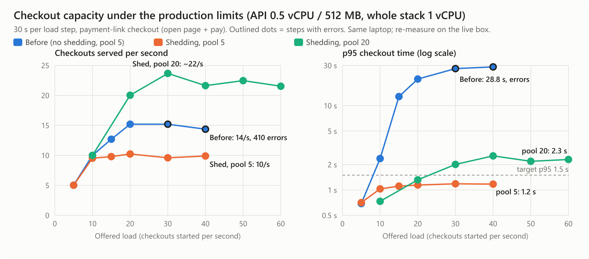

# Checkout capacity (2026-10-30, local; re-measure on the live box)

The judges' scenario is a fixed checkout under load. Ours: a buyer opens a
payment link and pays it (`GET /v1/payment-links/:token`, then
`POST …/pay`). This ran on the production-shaped stack (`ops/docker-compose.yml`
alone: API 0.5 vCPU / 512 MB, whole stack 1 vCPU, `NODE_ENV=production`),
30 s per load step, each step on fresh links.



## Our estimate

| | |
|---|---|
| **Sustained, fast and correct** | **20 checkouts/s** (~72,000 an hour): all served, p95 1.3 s, 0 errors |
| **Peak served** | ~22–23 checkouts/s (p95 2.0–2.5 s) |
| **Past the limit** | Excess gets `503` + `Retry-After` in **1 ms** (p95); 0 errors at 3× capacity (60/s offered) |
| **Crash** | Docker restarts the API in ~7 s; checkouts cut off mid-flight are repaired within ~60–75 s; no money lost, none charged twice |
| **Bottleneck** | Postgres CPU at its 0.3 vCPU cap. API: 10–20 % of its 0.5 vCPU, ~100–115 MB of 512 MB |

## What the first measurement found

| Offered (per s) | Before: served, p95, errors | Shedding, pool 5 | Shedding, pool 20 |
|---|---|---|---|
| 10 | 10.0, 2.4 s, 0 | 9.5, 1.0 s, 0 | **10.0, 0.7 s, 0** |
| 20 | 15.2, **20.7 s**, 0 | 10.2, 1.1 s, 0 | **20.0, 1.3 s, 0** |
| 30 | 15.2, **27.5 s**, **161** | 9.6, 1.2 s, 0 | 23.7, 2.0 s, 0 |
| 40 | 14.4, **28.8 s**, **410** | 9.9, 1.2 s, 0 | 21.6, 2.5 s, 0 |
| 60 | — | — | 21.5, 2.3 s, 0 |

**Before** (original code): past ~10/s nothing was turned away. Requests
queued for a database connection (pool of 5, held through each 100–400 ms
acquirer call), waited up to 5 s, then failed. Worse, **money went wrong**:
checkouts that failed part-way left 73 links "paid" with the money only
authorized, 41 open authorizations holding buyers' cards, and 276 links
stuck reserved. The CPU was nearly idle; the pool was the limit.

## Fixes, in order

1. **Bug 73:** each checkout step now undoes what came before it when it
   *throws* (e.g. a pool timeout), as it already did for a returned failure.
2. **Load shedding:** once requests are already queued for a database
   connection, new ones get an immediate `503` + `Retry-After` (health
   checks exempt). Latency stays flat instead of climbing to 28 s.
3. **Pool size 5 → 20** (`PG_POOL_MAX`): connections mostly wait on the
   acquirer, so more of them double throughput on the same CPU, until
   Postgres CPU becomes the limit.
4. **Bug 74:** a crash kills checkouts where no undo can run. Recovery at
   boot and every minute undoes any checkout abandoned longer than the
   60 s reservation timeout.

## Correctness checks after every run (`perf/checkout/invariants.sql`)

- Every paid link has exactly its captured transaction, for its amount.
- No link is left reserved.
- No captured sale sits behind an unpaid link.
- No authorization is left open.

The original code failed three of these under load. After the fixes, every
run passes, including the crash run (checked after the recovery pass).

## Reproduce

```bash
docker compose -f ops/docker-compose.yml up -d                 # production-only stack
perf/checkout/run.sh <label> "10 20 30 40 50 60" 30s           # ramp; writes results-<label>.jsonl
perf/checkout/crash.sh 20                                      # kill the API mid-load, then check
node perf/checkout/chart.mjs                                   # this chart
```

**Caveats.** The load generator ran on the same laptop. Docker's CPU limits
copy the *share* of a CPU, not the live box's core speed, so the live
re-measurement is the number to submit. The acquirer is the in-process
simulator (100–400 ms per call, ~2 % declines). Its idempotency caches are
unbounded maps, which stayed flat at test scale but grow without limit over
a long life.
