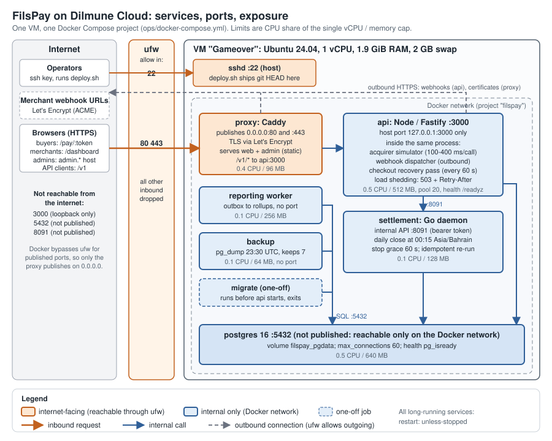

## 2. Architecture and deployment



FilsPay runs on one Dilmune Cloud VM (Ubuntu 24.04, 1 vCPU, 1.9 GiB RAM, 2 GB swap) as a single Docker Compose project, `ops/docker-compose.yml`. The firewall (ufw) lets in only ports 22, 80 and 443.

| URL | What it is |
|---|---|
| https://165-232-180-63.sslip.io | Hosted checkout (`/pay/:token`) and merchant dashboard (`/dashboard/login`) |
| https://admin.165-232-180-63.sslip.io | Admin console |
| https://165-232-180-63.sslip.io/v1 | Public API (the proxy forwards `/v1/*` to the API) |

Only two things face the internet: **sshd (22)** for deploys and the **Caddy proxy (80/443)**. Everything else is internal. Docker skips ufw for any port a container publishes, so we publish only the proxy on all interfaces. The API binds to `127.0.0.1:3000` on the host. Postgres and the settlement daemon publish nothing at all.

### Services

| Service | Port | Exposure | Limits (CPU / memory) | Restart policy | Health check |
|---|---|---|---|---|---|
| **proxy** (Caddy) | 80, 443 | **Internet**: TLS with Let's Encrypt (auto-renew); serves the web and admin apps as static files; `/v1/*` goes to `api:3000` | 0.4 / 96 MB | unless-stopped | none; starts only once the API is healthy |
| **api** (Node, Fastify) | 3000 | Internal, plus host loopback `127.0.0.1:3000` | 0.5 / 512 MB (V8 heap 384 MB) | unless-stopped | `GET /readyz` every 10 s, 40 s start period (`/healthz` = liveness) |
| **settlement** (Go daemon) | 8091 | Internal only; bearer token required | 0.1 / 128 MB | unless-stopped, **stop grace 60 s** | none |
| **reporting** worker | none | Internal only | 0.1 / 256 MB | unless-stopped | none |
| **backup** (pg_dump) | none | Internal only | 0.1 / 64 MB | unless-stopped | none |
| **postgres** 16 | 5432 | Internal only (not published) | 0.5 / 640 MB | unless-stopped | `pg_isready` every 2 s |
| **migrate** (one-off) | none | Internal only | 0.5 / 384 MB | runs once per deploy, then exits | must exit 0 before api, settlement and reporting start |

Three things run inside the API process rather than as separate services:
- **Acquirer simulator:** 100–400 ms per call, about 2 % declines.
- **Webhook dispatcher:** sends signed HTTPS calls out to merchant endpoints.
- **Checkout recovery pass:** at boot and every 60 s, it undoes checkouts abandoned mid-way (bug 74).

The CPU limits are ceilings on the one shared vCPU, not reservations, so they add up to more than 1. Every service rotates its logs (json-file, 3 × 10 MB).

### The one command to redeploy

```bash
DEPLOY_HOST=165.232.180.63 DEPLOY_USER=dilmune ops/deploy.sh
```

Run from a laptop with the deploy SSH key, it does the following:
1. **Refuses during the settlement window**, 23:55–00:30 Bahrain time, unless `FORCE=1` (see below).
2. **Ships exactly the committed `HEAD`** with `git archive`, not the working tree. It warns if there are uncommitted local changes. Line endings are shipped as committed (LF), so shell scripts work on the server.
3. **Swaps the code on the server.** It replaces the code in `~/filspay` but **keeps `ops/.env`**, and writes the revision to `~/filspay/REVISION`.
4. **Builds, migrates and starts.** It runs `docker compose -p filspay -f ops/docker-compose.yml up -d --build --remove-orphans`, which rebuilds images, runs the `migrate` job first, then starts the services in dependency order. The fixed project name keeps the database, KYC-upload, certificate and backup volumes across deploys.
5. **Tidies up and reports.** It rebuilds the optional seed image, prunes the build cache, then prints container status, disk and memory.

### Where secrets come from

- **Created on the server, once.** `ops/init-env.sh` runs on the server a single time and writes `ops/.env` with fresh random values from `openssl rand`: the database password, the webhook-secret encryption key, the settlement internal token, the acquirer-callback signing secret, and the fixture-account passwords. The file is created with permissions 600 and the script never overwrites an existing file.
- **Never leaves the box.** `ops/.env` is not in git, deploys never copy it, and `deploy.sh` keeps it when it replaces the code.
- **Missing values stop the deploy.** Every secret in the compose file is written as `${VAR:?…}`, so a missing value stops `docker compose up` with a message instead of starting with an empty secret.
- **Bug 72:** a committed `.env.docker` held a secret. It was removed; secrets now exist only in the untracked file.
- **Bug 76:** the demo accounts' passwords used to be constants in the public repo. They are now generated per deployment, and the live accounts were reset.

### Health checks and restart policies

- **Restarts.** Every long-running service has `restart: unless-stopped`. In a crash test (laptop) Docker restarted the API in about 7 s. Checkouts cut off by the crash were repaired by the recovery pass, and the money invariants held (see Capacity).
- **What the health checks do.** They control **start order**: the API waits for a healthy Postgres and a finished migration, and the proxy waits for a healthy API. So a deploy never sends traffic to an API that cannot reach its database.
- **What they don't do.** `/readyz` reflects readiness at boot only, and Docker does not restart a container just for being unhealthy. Crash recovery comes from the restart policy, not from the health check.

### How a redeploy avoids interrupting a settlement run

The settlement daemon closes and pays out yesterday's batches at **00:15 Asia/Bahrain** (UTC+3, no daylight saving; 21:15 UTC). The run takes about 4 s for 2,000 merchants after the batch N+1 fix. A redeploy recreates the settlement container, so there are three layers of protection:

1. **The deploy script refuses the window.** Between 23:55 and 00:30 Bahrain (20:55–21:30 UTC) `ops/deploy.sh` stops with a message unless `FORCE=1` is set. It computes this from `date -u`, so it doesn't depend on the laptop's time zone.
2. **Docker waits long enough.** Docker normally kills a container 10 s after asking it to stop. Settlement has `stop_grace_period: 60s`, longer than its own 30 s limit for draining internal-API requests (`shutdownTimeout`, `apps/settlement/internal/internalapi/server.go`). On a stop signal the daemon cancels its work: an open batch transaction **rolls back**, so nothing is left half-written.
3. **Re-running is safe and automatic.** Each merchant's close and its payout are each one database transaction that locks the batch row. Re-running a day skips batches already closed or paid. The daemon re-checks the day as soon as it starts, so a restarted daemon finishes an interrupted run within seconds. It also refuses to close a day that has not ended yet (bug 40), so restarting just before midnight cannot close today early.

### Backups

- **What and when:** the `backup` service writes a compressed `pg_dump` every night at 23:30 UTC (02:30 Bahrain, well clear of settlement) into its own volume, and keeps 7 days. `sh /ops/backup.sh now` takes one on demand. Restore steps are in `ops/README.md`.
- **What it protects against:** the dumps sit on the same disk as the database, so they guard against mistakes and bad migrations, not against losing the VM. Copying them off the box is the next step.
