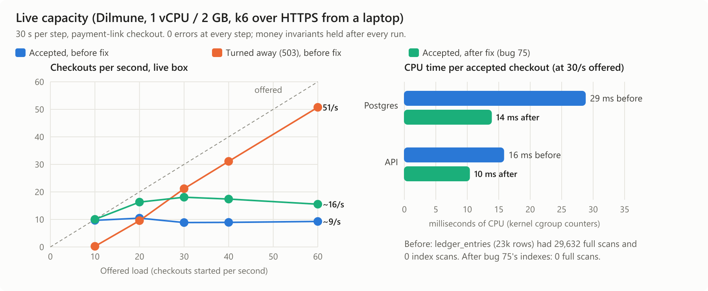
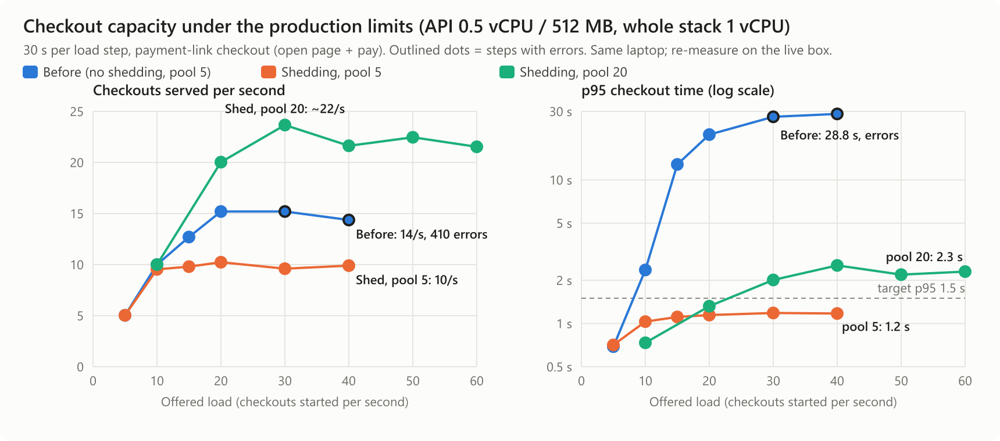
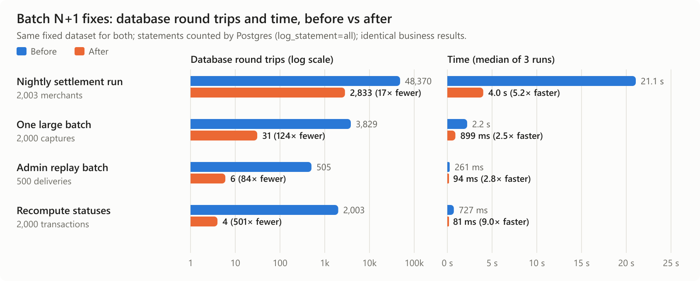

## 3. Capacity

### Our estimate in one line

**About 1,200 simulated buyers per minute (20 checkouts a second, ~72,000 an hour) completing checkout with no errors.** With a realistic 30 s pause between opening the link and paying, that is **about 600 buyers on the site at the same time**. Above that, extra buyers are refused at once with `503 Service Unavailable` + `Retry-After: 1` and lose no money.

### What a "simulated user" is

The fixed scenario is a checkout. **One simulated user** is one buyer who opens a payment link (`GET /v1/payment-links/:token`), thinks for **T** seconds, then pays (`POST /v1/payment-links/:token/pay`). Each user is one checkout.

- **Users per minute** = checkouts per second × 60.
- **Users on the site at once** (Little's law) = checkout rate × time each user spends = **X × (T + R)**.
  - X = checkouts per second we sustain = **20**
  - R = time the two requests take = **1.05 s** (median measured at 20/s on the live box, from a laptop over HTTPS)
  - T = thinking time between opening the link and paying. Thinking costs the server nothing: no connection or reservation is held while the page is open.

| Think time T | Users on the site at once (20 × (T + 1.05)) | Users per minute |
|---|---|---|
| 0 s (our load test: no pause) | ~21 | 1,200 |
| 10 s | ~220 | 1,200 |
| 30 s | ~620 | 1,200 |
| 60 s | ~1,220 | 1,200 |

Users per minute stays the same whatever the think time; only how many are on the page at once changes.

### Estimated vs measured

| | Before measuring | Measured on the live box |
|---|---|---|
| CPU cost of one checkout | Postgres 14 ms, API ~10 ms, proxy ~2 ms ≈ 26–29 ms of the one vCPU | At 20/s: Postgres 34 %, API 21 %, proxy 4 % of a core (≈ 29 ms per checkout) |
| Ceiling if CPU were the only limit | ~34 checkouts/s | not reached |
| Ceiling from the connection pool | 20 connections, each held ~0.6–1 s (acquirer call + database work) ≈ 20–30/s | **20/s sustained, 21/s peak** |
| Sustained users per minute | ~1,200–1,800 | **1,200** |
| Overload behaviour | refuse, don't queue | **0 errors at 150/s offered (7.5×)**; excess refused with 503 |

### Our load test: tool, method, results

- **Tool:** k6 (`grafana/k6:0.52.0`), scenario `perf/checkout/checkout.js`, `constant-arrival-rate`. New checkouts start at a fixed rate whether or not the server keeps up, so overload shows up as refusals or errors instead of quietly slowing the test down.
- **Method:** `perf/checkout/run-live.sh` drives the **live box** over public HTTPS from a laptop. It creates fresh payment links for each step in the server's database, runs 30 s at each rate, and records each container's CPU from the kernel's cgroup counters (`perf/checkout/cgroup-cpu.sh`). After every run it checks the money invariants (`perf/checkout/invariants.sql`). Results are in `perf/checkout/results-live-*.jsonl`.
- **Money invariants:** every paid link has exactly its captured transaction for its amount; no link is left reserved; no captured sale sits behind an unpaid link; no authorization is left open. **All four held after every run.**

**Final configuration (live).** "Accepted" means served and answered (paid or declined); refusals are the 503s.

| Offered per s | Accepted per s | Refused (503) | Errors | p95 (client) |
|---|---|---|---|---|
| 10 | 10.0 | 0 | 0 | 1.6 s |
| 20 | **20.0** | 0 | 0 | 2.1 s |
| 60 | 21.0 | 1,170 | 0 | 2.6 s |
| 100 | 18.5 | 2,447 | 0 | 3.4 s |
| 150 | 16.6 | 4,003 | **0** | 3.5 s |

The 10/s and 20/s rows were measured before the proxy's CPU was raised 0.15 → 0.4; the proxy uses 4 % of a core at 20/s, so that change does not affect them. An earlier configuration peaked at 26/s accepted at 60/s offered. It then failed at 150/s: the proxy was too short of CPU to refuse quickly, and 1,076 requests timed out. We kept the configuration that never fails.

Full detail: [`docs/perf/2026-10-30-checkout-capacity.md`](../perf/2026-10-30-checkout-capacity.md).

### Where the bottleneck is

- **It was Postgres CPU.** Before bug 75, and with Postgres capped at 0.3 vCPU, the kernel's counters showed Postgres throttled at its limit **87–95 % of the time** while the box was about half idle. `docker stats` showed ~5 % because it misses throttled containers, so we measure with cgroup `cpu.stat` instead.
- **Bug 75 was the cause.** The balance check on every ledger posting scanned the whole ledger (29,632 full scans per run, 0 index scans). Migration 0085 added the missing indexes, which halved Postgres CPU per checkout (29 → 14 ms). We then raised the Postgres ceiling to 0.5 and the proxy's to 0.4.
- **Now it is concurrency.** At 60/s offered, no container is pinned: Postgres uses 35 % of a core (throttled 12 %), the API 28 %, the proxy 9 %. Each checkout holds one of the API's 20 database connections through the 100–400 ms acquirer call. So throughput is about 20 connections ÷ time held, and shedding starts once 20 requests are already waiting.
- **The next limit** is the single vCPU, which is already about three-quarters busy at 60/s offered. Every refusal still costs a TLS handshake, which is why accepted throughput eases from 21 to 17/s as offered load goes from 60 to 150/s.

### How the stack turns away excess load

**Load shedding in the API** (`apps/api/src/app.ts`): when requests are already queued for a database connection, a new request gets an immediate **`503` with `Retry-After: 1`** instead of waiting. Health checks are never shed.

- **Speed:** refusals take **3–4 ms on the server** (p95, even at 150/s offered). At the client, where network and TLS are added, they take 0.3 s at 60/s, 0.5 s at 100/s and 1.1 s at 150/s.
- **Why it matters:** latency for accepted buyers stays flat (p95 2–3.5 s) instead of climbing until requests time out.

Before shedding, the original code queued everything:

| Offered per s | Original: served, p95, errors | With shedding, pool 20: served, p95, errors |
|---|---|---|
| 20 | 15.2, **20.7 s**, 0 | **20.0, 1.3 s, 0** |
| 30 | 15.2, **27.5 s**, **161** | 23.7, 2.0 s, 0 |
| 40 | 14.4, **28.8 s**, **410** | 21.6, 2.5 s, 0 |

(Laptop, same production limits; `results-baseline.jsonl`, `results-pool20.jsonl`.) The original code also **corrupted money** under load: checkouts that failed part-way left 73 links marked paid with the money only authorized, 41 open card authorizations, and 276 links stuck reserved. Bug 73 fixed it: each checkout step now undoes the earlier ones when it throws.

### How it recovers from a crash

`perf/checkout/crash.sh` kills the API's Node process with `kill -9` 20 s into a 60 s run at 20 checkouts/s (laptop, production limits):

- **Restart:** Docker (`restart: unless-stopped`) brings the API back in **about 7 s**. Meanwhile the proxy returns errors for new requests; nothing queues up.
- **Repair:** a crash kills checkouts where no undo can run. The **recovery pass** (bug 74), run at boot and every 60 s, undoes any checkout abandoned longer than the 60 s reservation timeout. Within **~60–75 s** every interrupted checkout was repaired.
- **Result:** all four invariants hold after the recovery pass. No money was lost and no buyer was charged twice.

### Before and after: performance fixes

**Bug 75 (missing ledger indexes), live box:**

| Offered per s | Before: accepted, p95 | After: accepted, p95 |
|---|---|---|
| 10 | 9.7, 4.8 s | **10.0, 3.0 s** |
| 20 | 10.5, 4.6 s | **16.3, 3.1 s** |
| 30 | 8.9, 6.0 s | **18.1, 2.9 s** |
| 60 | 9.3, 5.2 s | **15.5, 3.2 s** |

Postgres CPU per checkout went 29 → 14 ms, and full-ledger scans went from 29,632 to 0. With the later CPU-ceiling changes, the final result is 20/s sustained.

**Batch N+1 fixes** (settlement and admin batch jobs; fixed dataset, median of 3 runs):

| Operation | Round trips before → after | Time before → after |
|---|---|---|
| Nightly settlement run (2,003 merchants, 100 active) | 48,370 → **2,833** | 21.1 s → **4.0 s** |
| One large batch (2,000 captures) | 3,829 → **31** | 2.2 s → **0.9 s** |
| Admin replay batch (500 deliveries) | 505 → **6** | 261 → **94 ms** |
| Recompute statuses (2,000 transactions) | 2,003 → **4** | 727 → **81 ms** |

The settlement daemon and the API share one vCPU, so the nightly run now holds the database for 4 s instead of 21 s. Old and new code produced identical totals on the same data.

Full detail: [`docs/perf/2026-10-30-batch-n-plus-1.md`](../perf/2026-10-30-batch-n-plus-1.md).

### Caveats

- The load generator ran on a laptop over the public internet, so client times include about 0.2 s of network per request.
- The acquirer is the in-process simulator, not a real card network.
- We have not tested past 150/s offered.
- The crash test ran on the laptop with the same container limits, not on the live box.
