## 5. UI and UX changes

Screenshots were taken at 1280×800 with headless Chrome over the DevTools protocol. Both versions ran locally under Docker with the same deterministic seed, signed in as the Alpha Retail Co owner (merchant dashboard) and as admin fixtures (console).

- **Before:** the original challenge commit `8b58b0f`. It can't start on a fresh database as shipped, so it got the minimum patch to run:
  - the missing Dockerfiles were copied in (they were never committed);
  - the broken 0054 view and 0055 insert were disabled, exactly as our commit 6583411 does (bug 01);
  - a valid `WEBHOOK_SECRET_ENCRYPTION_KEY` was supplied, because the built-in dev key decodes to 34 bytes and the API and seed crash at boot without it.
- **After:** the current code.
- **Frontends:** in both cases, the production build from `ops/Dockerfile.proxy`'s build stage, served same-origin with `/v1` forwarded to the API.

### 5.1 The site root goes to sign-in

**What:** `https://<host>/` now redirects to `/dashboard/login`.
**Why:** the web app has no page at `/`. Anyone typing the bare domain, including the judges, got React Router's raw "Unexpected Application Error! 404 Not Found".

| Before | After |
|---|---|
|  | 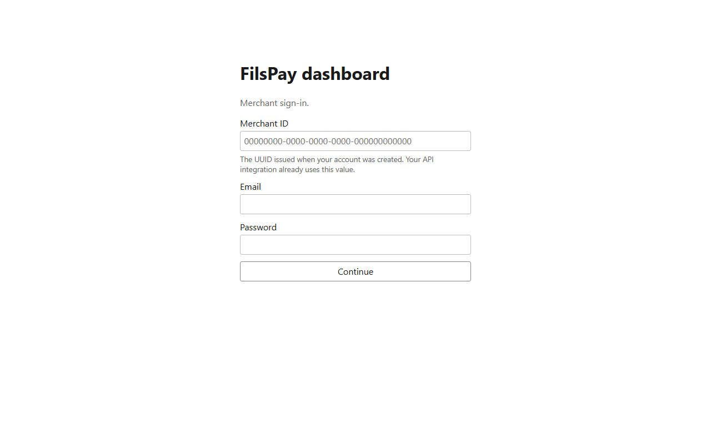 |

*Before: the original build at `/`. After: the redirect is in `ops/Caddyfile` (`redir / /dashboard/login`). Locally the static server reproduced that one rule, which is not Caddy itself.*

### 5.2 A refunded transaction no longer crashes the dashboard (bug 34)

**What:** the dashboard's money formatter now accepts signed amounts, so a refund (−40.000 BHD on the timeline) renders.
**Why:** refunds are stored as negative timeline amounts by design, and `bhd()` threw on any negative number. Every refunded transaction page, and any reconciliation with a negative gap, was a white error screen.

| Before | After |
|---|---|
| 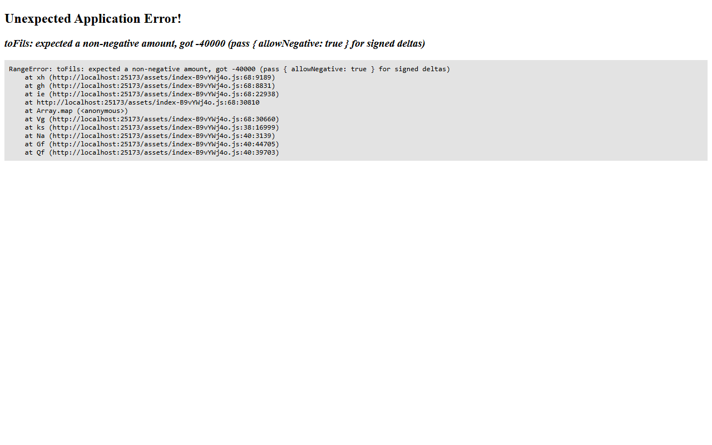 | 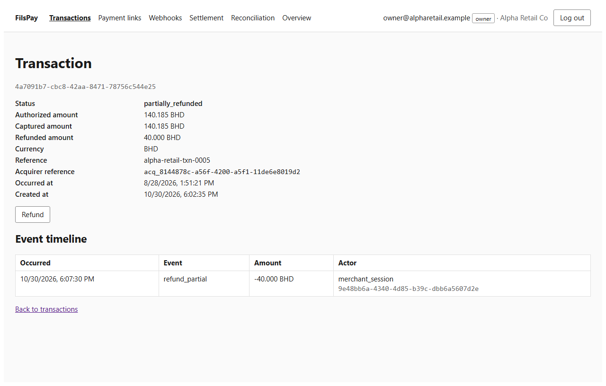 |

*Same seed transaction `alpha-retail-txn-0005` (captured 140.185 BHD) on both.*
- *Before: the original API answered every refund with 501, so a refund couldn't be made. One `refund_partial` timeline row of −40,000 fils was inserted into the before database by SQL, in the same shape the engine writes. The crash is the original front-end code.*
- *After: a real 40.000 BHD partial refund made through the dashboard.*

### 5.3 Refunds can be issued from the dashboard (FP-300, bug 35)

**What:** the transaction page now has a Refund control (owner/finance). It takes:
- an amount in BD, parsed exactly; blank means "everything still refundable";
- an optional reason;
- a "Left to refund" figure.

It confirms before sending, uses one idempotency key per submission, and adds a "Refunded amount" row.

**Why:** FP-300 was the missing feature. Before, the drawer was unwired, the import was removed, and the API answered `POST /v1/refunds` with `501 {"error":"not_implemented"}`. The dashboard's own path, `/v1/merchants/:id/refunds`, didn't exist (404). A merchant had no way to refund.

| Before | After |
|---|---|
| 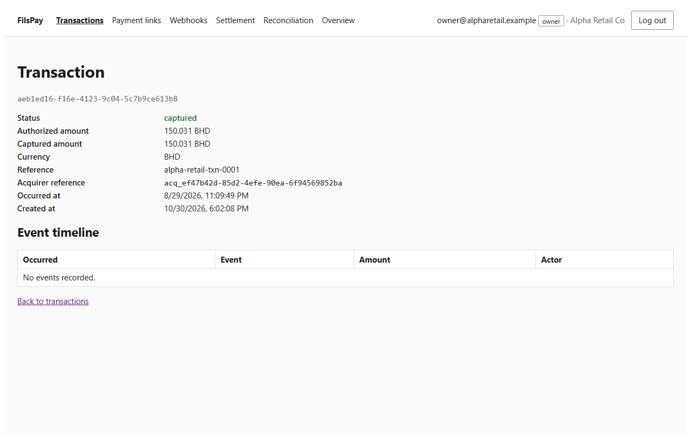 | 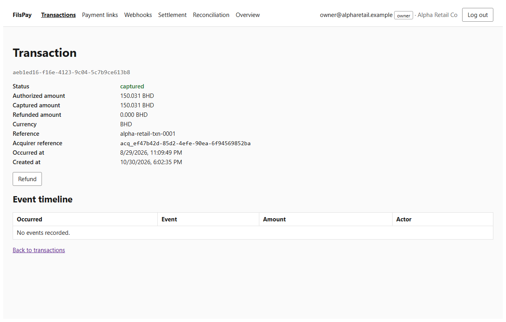 |

*Same seed transaction (`alpha-retail-txn-0001`, 150.031 BHD captured) on both. The drawer in use is shown in the refund demo below.*

### 5.4 Refunds appear in the Overview (bug 58)

**What:** the Overview's daily volume table has a "Refunded" column: amount and count, bucketed by Bahrain business day.
**Why:** the reporting worker ignored `refund.succeeded`, so a day with refunds looked like a clean sales day.

| Before | After |
|---|---|
| 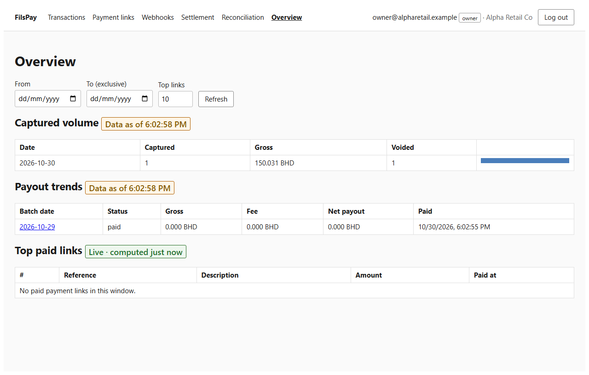 |  |

*After: 80.250 BHD (3) = 25.000 + 15.250 + 40.000 BHD, the refunds made in this session. The before stack had no refunds to show, since none were possible. The table simply has no column for them.*

### 5.5 The admin console shows the fee actually charged (bug 18)

**What:** "Current fee schedule" on the merchant page now uses the same rule as capture: the newest row whose effective date has arrived, with ties going to the later-entered row.
**Why:** staff quote and check merchants against this screen. For Alpha Retail it showed 2.45% (245 bps, the March correction entered last), while capture charges 2.25% (225 bps, effective 1 Aug).

| Before | After |
|---|---|
| 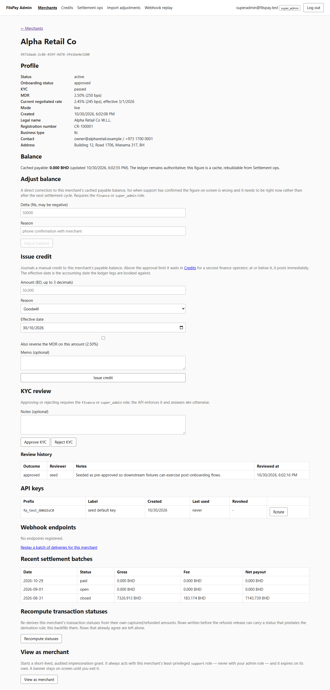 |  |

### 5.6 "Rotate" really revokes the old API key (bug 05)

**What:** after rotation, the old key's "Revoked" column shows the time, and it can't be rotated again.
**Why:** the confirmation says "the current key is revoked and a replacement is issued", but the old key stayed live. Each click minted another working key, so rotating after a leak did nothing.

| Before | After |
|---|---|
| 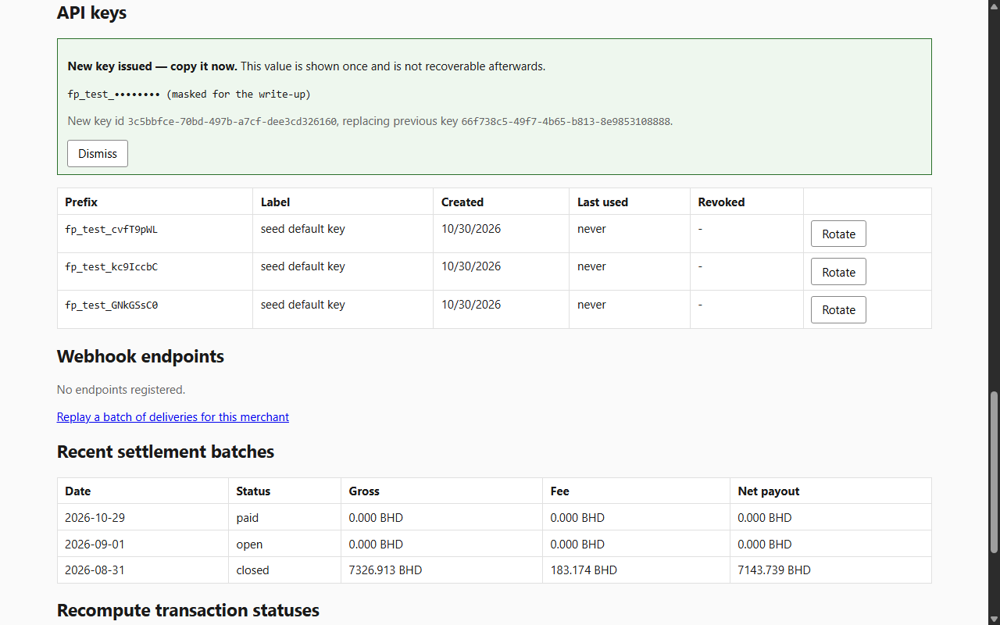 | 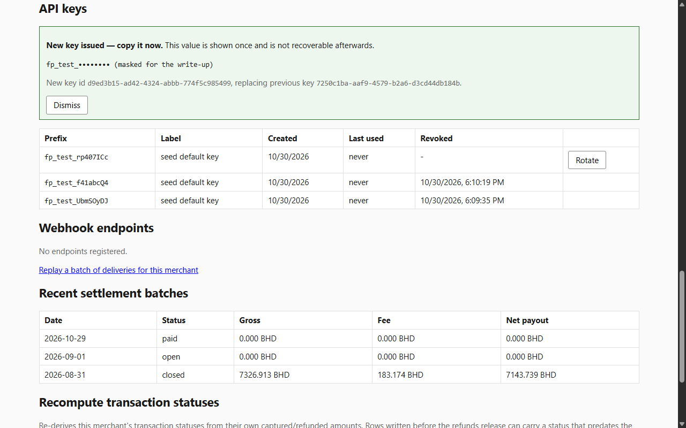 |

*Both: Alpha Retail, rotated twice by the finance admin. The new raw key is masked in the images.*

### 5.7 Merchants stay signed in after 10 minutes (bug 59), no visual

**What and why:** OTP verify now re-issues the session cookie with the 12-hour lifetime. Before, the browser kept the 10-minute pending cookie and dropped a valid session mid-task. The evidence is in the response headers, recorded against both local APIs (token truncated):

```
before  POST /v1/auth/login       Set-Cookie: fp_sid=…; Max-Age=600;   Path=/; HttpOnly; SameSite=Lax
before  POST /v1/auth/otp/verify  (no Set-Cookie)
after   POST /v1/auth/login       Set-Cookie: fp_sid=…; Max-Age=600;   Path=/; HttpOnly; SameSite=Lax
after   POST /v1/auth/otp/verify  Set-Cookie: fp_sid=…; Max-Age=43200; Path=/; HttpOnly; SameSite=Lax
```

### Refund demo (fallback screenshots)

These are fallback screenshots for the live demo, recorded on the local after stack on 2026-10-30 as the Alpha Retail Co owner. 1 BD = 1,000 fils.

1. **Buyer pays two payment links** on `/pay/:token` with the simulator test card: 25.000 BD (25,000 fils) and 40.000 BD (40,000 fils). Link payments are captured straight away.
   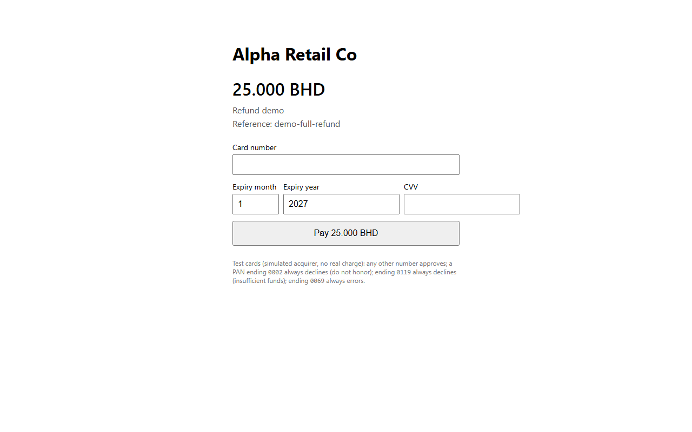 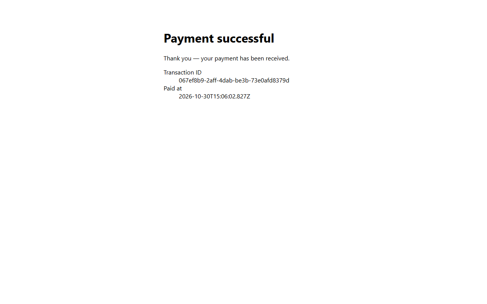
2. **Full refund:** on the 25.000 BD transaction, Refund with the amount left blank (meaning everything refundable) and reason "Customer returned the order". After the confirm dialog ("Refund 25.000 BHD? …"):
   - status `refunded`, Refunded amount 25.000 BHD;
   - timeline `refunded −25.000 BHD`, actor `merchant_session`.
   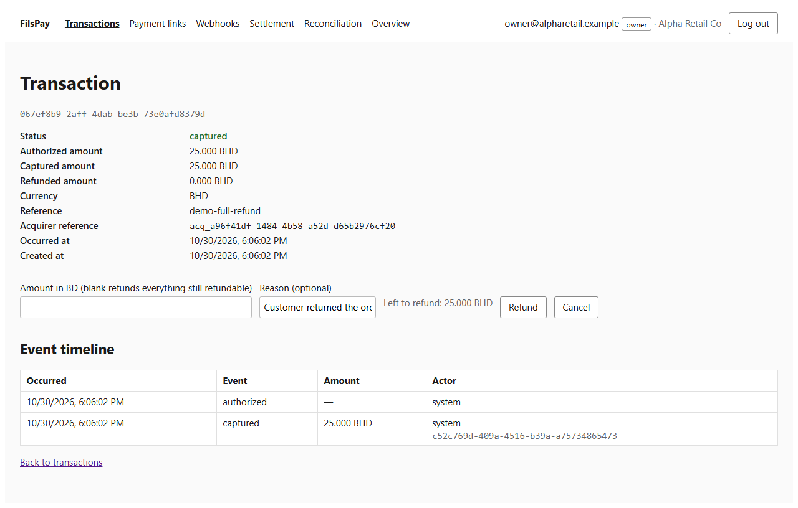
   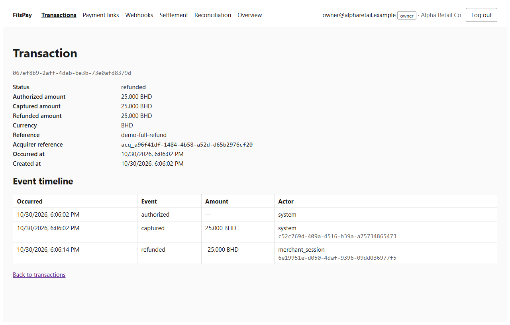
3. **Partial refund:** on the 40.000 BD transaction, amount 15.250 (15,250 fils) and reason "One item out of stock". The drawer shows "Left to refund: 40.000 BHD". Afterwards:
   - status `partially_refunded`, Refunded amount 15.250 BHD (24.750 BHD still refundable);
   - timeline `refund_partial −15.250 BHD`.
   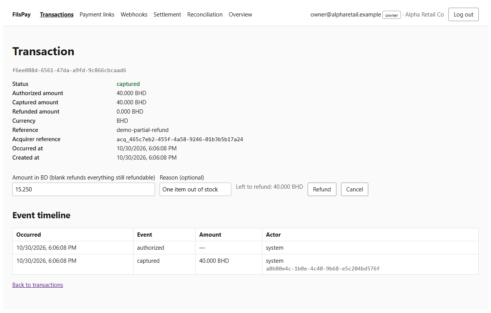
   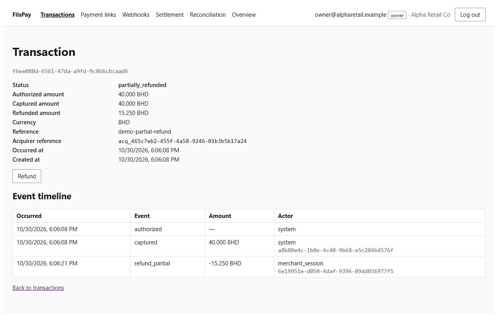
4. **Dashboard totals:** the Overview for 2026-10-30 shows Refunded **80.250 BHD (3)**. That is these two refunds (25.000 + 15.250) plus the 40.000 BD partial refund from section 5.2. Captured/Gross for the day also includes a seed-fixture capture of 150.031 BHD, and the one void is also seed data.
   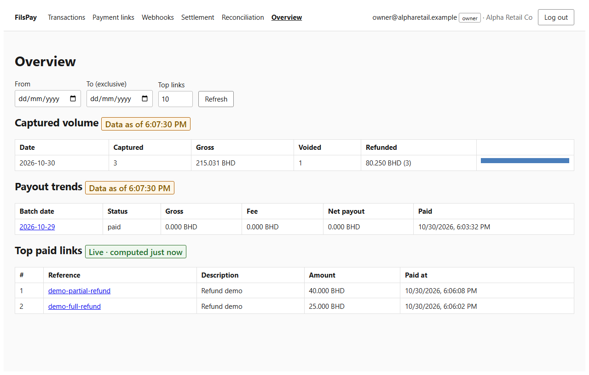
5. **Reconciliation:** 30/09–31/10 reports "Reconciled — no gap". Ledger merchant payable (net) −14.807 BHD = pending, not yet batched −14.807 BHD, so the refunds are counted in the pending queue.
   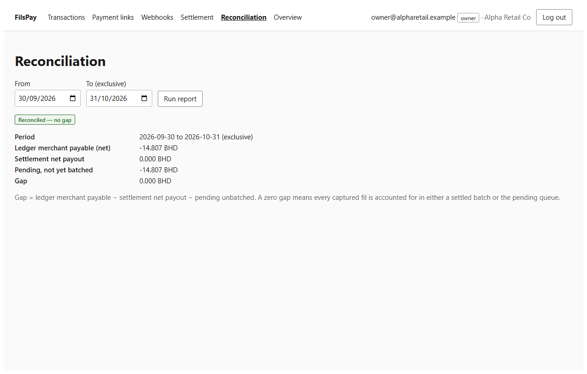
6. **Settlement:** today's batch can't be closed yet. `settlement run-batch --date=2026-10-30` answers "business day has not ended yet". That is the bug 40 fix: a Bahrain business day is only settled once it is over. The batch list is shown as it stands. Today's refunds settle in the 2026-10-30 batch after midnight Bahrain time. No data was backdated to force a batch.
   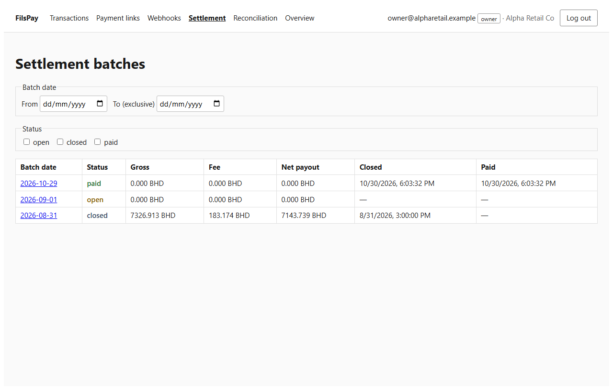
